# gh-view-counter

A self-hosted, zero-cost view counter badge for GitHub profiles and repositories.

<p>
  
  &nbsp;
  
</p>


## In plain terms

A GitHub profile page can't run its own code, so it can't count its visitors. It can show pictures, though. This project turns that picture into the counter.

The profile shows a small badge image. Every time someone opens the profile, GitHub has to fetch that image from this tool. Each fetch counts as one visit: the tool adds one to a running total it keeps in a small database, draws a fresh badge with the new number, and sends it back. The tool also tells GitHub not to save a copy of the image, so the next visitor triggers a new fetch and a new count.

The badge can be a slim pill or a small card that also shows today's visits and a 30-day trend line. The tool runs on Cloudflare's free plan, so it costs nothing to host.

---

## Contents

- [Quick start](#quick-start)
- [Styles](#styles)
- [How it works](#how-it-works)
  - [Why it's an image](#1-why-its-an-image)
  - [The path of a single page view](#2-the-path-of-a-single-page-view)
  - [Defeating the cache](#3-defeating-the-cache)
  - [Inside the Worker](#4-inside-the-worker)
  - [Counting without losing views](#5-counting-without-losing-views)
  - [Drawing the badge](#6-drawing-the-badge)
  - [When things go wrong](#7-when-things-go-wrong)
  - [What the number actually means](#8-what-the-number-actually-means)
- [Free-tier capacity](#free-tier-capacity)
- [Deploy](#deploy)
- [Usage](#usage)
- [Configuration](#configuration)
- [Development and testing](#development-and-testing)
- [Project layout](#project-layout)

---

## Quick start

After [deploying](#deploy), add one line to your profile's `README.md`:

```markdown

```

Or use the stats card:

```markdown

```

---

## Styles

### `modern` (default)

A pill-shaped badge. An eye icon and the label sit on a dark tab, and the count sits on a rounded gradient segment that overlaps the tab. A soft top highlight and a hairline inner border give it depth, and a light sweep crosses the gradient once when the page loads.

| URL parameters | Result |
| --- | --- |
| *(none)* |  |
| `color=teal` |  |
| `color=rose&label=Visitors` |  |
| `color=amber&labelColor=f6f8fa` |  |
| `label=&abbreviated=true` |  |

### `card`

A 104px-tall card with the label, the total in large type, today's views, and a smoothed 30-day trend line with a gradient fill. A soft pulse rings the latest point. With the default `theme=auto` the card follows each viewer's light or dark mode, using GitHub's own palette. `theme=light` or `theme=dark` fixes it.

| `theme=light` | `theme=dark` |
| --- | --- |
|  |  |

`color` sets the accent. For example, `color=emerald&theme=dark`:



### Classic

The shields.io-compatible styles are still available, so the badge can match other shields badges.

| `style` | Result |
| --- | --- |
| `flat` |  |
| `flat-square` |  |
| `for-the-badge` |  |

The images above are generated from the real renderer with `npm run examples`. The card's trend line uses sample data.

---

## How it works

The system has three parts:

| Part | Role |
| --- | --- |
| **GitHub's camo image proxy** | Fetches the badge on behalf of every visitor |
| **A Cloudflare Worker** (`src/`) | Validates the request, counts the view and renders the SVG |
| **A Cloudflare D1 database** (`migrations/`) | Stores a running total per counter, plus one row per counter per day for the trend line |

### 1. Why it's an image

GitHub renders `README.md` files to HTML and then sanitizes the result. It strips `<script>` tags, inline event handlers such as `onload`, `<iframe>`s and anything else that could run code in a visitor's browser. That rules out the usual analytics approach of loading a JavaScript snippet.

Images survive sanitization. Fetching an image is an HTTP request, and an HTTP request can be counted. The badge is that image, and the server behind it is the counter. Because the image is an SVG built on the fly rather than a static file, the server can write the current number into it.

### 2. The path of a single page view

```
 Visitor's browser             GitHub                          Cloudflare (nearest data center)
 ─────────────────   ─────────────────────────────   ───────────────────────────────────────────
 opens profile ────▶ renders README to HTML;
                     rewrites the image URL to
                     camo.githubusercontent.com/<hmac>/<hex-encoded-url>
 requests image ───▶ camo proxy ─── GET /?user=x ───▶ Worker
                                                        ├─ validate username / repo
                                                        ├─ check allowlist
                                                        ├─ D1 batch: total += 1, today += 1
                                                        ├─ (card only) read the last 30 days
                                                        └─ render SVG
                     camo ◀── 200 image/svg+xml ──────── Cache-Control: no-store
 badge shows N ◀──── camo forwards the image
```

1. **GitHub rewrites the URL.** When GitHub renders the README, it replaces every external image URL with a `camo.githubusercontent.com` URL. That URL contains the original address, hex-encoded and signed with an HMAC so camo can't be used as an open proxy. Visitors' browsers never contact the Worker directly. This protects their privacy and keeps every image on HTTPS.
2. **The browser asks camo for the image.** Camo checks the signature, decodes the original URL and makes its own `GET` request to the Worker.
3. **The Worker counts and renders.** The details are in [Inside the Worker](#4-inside-the-worker).
4. **Camo relays the SVG** back to the browser, which displays it like any other image.

### 3. Defeating the cache

If camo, a CDN or the browser kept a copy of the badge, later visitors would get that copy. No request would reach the Worker, so nothing would be counted, and the badge would show a frozen number.

Every badge response therefore carries:

```http
Content-Type: image/svg+xml; charset=utf-8
Cache-Control: max-age=0, no-cache, no-store, must-revalidate
Pragma: no-cache
Expires: 0
X-Content-Type-Options: nosniff
```

| Header | Effect |
| --- | --- |
| `no-store` | No cache may keep the response at all. This is the strongest instruction. |
| `no-cache`, `must-revalidate`, `max-age=0` | Backups for caches that don't fully honor `no-store`. They require a cache to check with the origin before reusing anything. |
| `Pragma` and `Expires: 0` | The equivalent instructions for old HTTP/1.0 caches |
| `X-Content-Type-Options: nosniff` | Stops browsers from guessing a different content type for the response |

The Worker sets no `ETag` or `Last-Modified`. Without them a cache can't send a conditional request and get back an empty `304 Not Modified`, so every request returns the full, freshly numbered badge.

### 4. Inside the Worker

The Worker (`src/index.js`) is a single `fetch` handler. For a badge request it does the following, in order.

**Routing.** It accepts only `GET` and `HEAD` requests and answers anything else with `405 Method Not Allowed`. `/`, `/badge` and `/badge.svg` serve the badge. `/api/views` returns JSON, and `/health` is a liveness check. A request to `/` without a `user` parameter returns a short plain-text usage guide.

**Validation** (`src/params.js`). The `user` parameter is lowercased and checked against GitHub's own username rules: 1–39 characters, letters, digits and single hyphens, with no hyphen at the start or end.

```js
/^[a-z0-9](?:[a-z0-9]|-(?=[a-z0-9])){0,38}$/
```

An optional `repo` parameter must match `[a-z0-9._-]{1,100}` and can't be `.` or `..`. The counter's database key is `user` or `user/repo`. Lowercasing means `JashanKish` and `jashankish` share one counter, just as GitHub treats them as the same account. Unknown `style` or `theme` values fall back to the defaults instead of failing.

**Allowlist.** If `ALLOWED_USERS` is set, any other username gets a "user not allowed" badge, and the Worker returns before touching the database. Without this, anyone could embed badges that point at your Worker and use up your free quota.

**The counting decision.** The Worker counts a view only if all of these are true:

| Condition | Why |
| --- | --- |
| The method is `GET`, not `HEAD` | A `HEAD` request only asks for headers, so it isn't a view |
| `preview=true` isn't set | Lets you look at the badge while designing it without raising the count |
| `COUNT_ONLY_CAMO` is off, or the `User-Agent` contains `github-camo` | Optionally ignores direct hits from browsers and scripts |

If any condition fails, the Worker just reads the current value without changing it.

**History, only when needed.** Only the `card` style shows the trend line, so only it reads the last 30 days of daily counts. The other styles skip that read.

**Display options.** `base` adds a fixed offset to the displayed number without changing what's stored, for example to carry over a count from another service. `abbreviated=true` formats large numbers compactly: `1,234` becomes `1.2k` and `3,200,000` becomes `3.2M`.

### 5. Counting without losing views

There are two tables (`migrations/`). `views` holds one running total per counter. `daily_views` holds one row per counter per UTC day and feeds the card's trend line.

```sql
CREATE TABLE IF NOT EXISTS views (
  id         TEXT    PRIMARY KEY,
  count      INTEGER NOT NULL DEFAULT 0,
  created_at INTEGER NOT NULL DEFAULT (unixepoch()),
  updated_at INTEGER NOT NULL DEFAULT (unixepoch())
) WITHOUT ROWID;

CREATE TABLE IF NOT EXISTS daily_views (
  id    TEXT    NOT NULL,
  day   TEXT    NOT NULL,          -- 'YYYY-MM-DD', UTC
  count INTEGER NOT NULL DEFAULT 0,
  PRIMARY KEY (id, day)
) WITHOUT ROWID;
```

Each view sends two statements to D1 in a single `batch()` (`src/db.js`):

```sql
INSERT INTO views (id, count) VALUES (?, 1)
ON CONFLICT(id) DO UPDATE SET count = count + 1, updated_at = unixepoch()
RETURNING count;

INSERT INTO daily_views (id, day, count) VALUES (?, ?, 1)
ON CONFLICT(id, day) DO UPDATE SET count = count + 1;
```

**Why the database does the addition.** The obvious approach is to read the count, add one in code and write it back. That loses views when two people load the page at the same moment:

```
request A: read 41            request B: read 41
request A: write 42           request B: write 42      ← one view lost
```

In the statements above, the database adds 1 itself. SQLite, which D1 is built on, runs writes one at a time, so concurrent views queue up and every one is counted. The same statements also cover the first view: when no row exists yet, the `INSERT` creates it with a count of 1.

**Why a batch.** D1 runs a batch as one transaction in one round trip. The total and today's count therefore always move together, and counting a view costs a single trip to the database.

**Why `RETURNING`.** It gives back the new total from the same statement, so the number on the badge is exactly the number written, with no second query.

**Why `WITHOUT ROWID`.** A normal SQLite table stores rows in one internal structure and keeps a separate index for a text primary key. `WITHOUT ROWID` stores each row directly in the primary-key index, so each table costs exactly one row written per view. That matters because D1's free tier is measured in rows.

**Reading the trend.** The card asks for every `daily_views` row from the last 30 days. Days with no views have no row, so the Worker fills those gaps with zeros, giving the trend line exactly 30 evenly spaced points, oldest first.

**Why D1 and not Workers KV.** KV is Cloudflare's simpler key-value store, but it doesn't fit a counter:

- **Write limit.** KV's free plan allows 1,000 writes a day, so the counter would stop at 1,000 views. D1 allows 100,000 rows.
- **No atomic increment.** KV is eventually consistent and has no increment operation, so it can only do the lossy read-then-write described above.

### 6. Drawing the badge

`src/badge.js` passes each request to a renderer in `src/styles/`. Every renderer builds the SVG as a plain string, with no libraries and no fonts to load.

**Measuring text without a font engine** (`src/text.js`). A Worker can't measure rendered text, so the code estimates each character's width from font metrics. There are two tables: Verdana for the classic styles, and the system UI font stack (San Francisco, Segoe UI, Helvetica, Arial) for `modern` and `card`. Narrow characters such as `i` and `.` count as about a quarter of the font size, digits as about 0.58 and wide letters such as `m` and `W` as about 0.8–0.86. Each `<text>` element also gets a `textLength` attribute, which tells the renderer to fit the text to exactly that width. If a viewer's system substitutes a different font, the text still fits its box. Numbers use `font-variant-numeric: tabular-nums`, so every digit takes the same width.

**Gradients from one color** (`src/color.js`). The `modern` and `card` styles use a two-stop gradient. The default runs from indigo (`#6366f1`) to purple (`#a855f7`). For any other `color`, the second stop is derived by converting the color to HSL, rotating its hue by 32° and lightening it slightly. One parameter is enough for a gradient that looks hand-picked.

**The modern pill** (`src/styles/modern.js`). The badge is 28px tall with fully rounded ends. The value segment is its own rounded shape, overlapping the dark label tab by 6px, with a faint shadow where they meet so it appears to sit on top. Two overlays add depth: a gradient that is lighter across the top half, and a 1px white inner border at 14% opacity. The eye icon is drawn in a lighter tint of the accent color, so it ties the two halves together.

**The card** (`src/styles/card.js`). The card is laid out on a 20px grid. The total is set in 30px bold type, and the trend line sits to its right. The card widens automatically when the total is long, so the two never overlap.

- **The trend line uses monotone cubic interpolation,** with harmonic-mean tangents (the Fritsch–Butland method). That draws a smooth curve through every daily value that never overshoots, so a quiet day next to a busy one can't make the line dip below zero.
- **Under the line,** a gradient fades the accent color from 32% opacity to transparent. A dashed baseline marks zero.
- **Light and dark mode.** Colors are applied through CSS classes. With `theme=auto`, an `@media (prefers-color-scheme: dark)` rule inside the SVG switches them to GitHub's dark palette, so the card matches whichever mode the viewer uses.

**Motion that degrades safely.** Browsers may stop repainting animated SVGs shown through `` tags, which can freeze a badge on its first frame. So the resting frame of every badge is the finished design, and animation only adds decoration on top. The pill's light sweep and the card's pulse both start fully transparent, so a frozen frame never hides anything. A test enforces this rule. Viewers who set "reduce motion" in their system settings see no animation at all, through a `prefers-reduced-motion` rule, and `animate=false` turns it off for everyone.

**Readable colors.** The code works out each background color's relative luminance. If it's above 0.65 (a light color), the text is dark; otherwise it's white. Text stays readable whatever colors you choose. The `modern-amber-light` example above shows this on both halves.

**Safe output.** An SVG can contain markup, so user input is never placed into it unchecked:

- Colors must match a known name or a strict hex pattern. Anything else, such as `red" onload="…`, falls back to the default color.
- Label and message text is XML-escaped (`&`, `<`, `>`, `"`, `'`), and labels are cut off at 40 characters.
- The usernames that make it into the database key have already passed the validation pattern.
- `style` and `theme` are checked against fixed lists.

**Accessibility.** Every badge has `role="img"`, an `aria-label` and a `<title>`, such as "Profile views: 1,234" or, for the card, "Profile views: 1,234 (+12 today)". Screen readers therefore announce the numbers.

### 7. When things go wrong

Camo shows a broken-image icon for any response that isn't a 2xx. So the badge endpoint always returns `200` with a red badge that explains the problem. Error badges keep the requested style, except that a card has no data to show, so it falls back to the pill.

| Badge shows | Cause |
| --- | --- |
| `missing ?user=` / `invalid user` / `invalid repo` | A bad or missing parameter |
| `user not allowed` | The username isn't in `ALLOWED_USERS` |
| `unavailable` | The database call failed. The error is logged and the request doesn't crash. |

The JSON endpoint `/api/views` uses normal status codes (`400`, `403`, `503`), since scripts expect them.

### 8. What the number actually means

- **It counts page loads, not unique visitors.** Every request comes from camo's servers, so the Worker never sees a visitor's IP address, cookies or real browser. Repeat visits, refreshes and your own views all count.
- **Anyone can raise the count** by requesting the URL repeatedly. Every public view counter has this problem. `COUNT_ONLY_CAMO=true` filters out casual hits, but a `User-Agent` header is easy to fake.
- **Some views go uncounted.** Visitors who block images, and readers of the raw Markdown, never request the badge.
- **"Today" means the current UTC day,** so it resets at midnight UTC rather than at midnight in your time zone.

---

## Free-tier capacity

Each view costs 1 Worker request and 2 D1 rows written (the total and today's count). It also reads 1 row, or up to 31 for the card.

| Resource | Free limit | Max views/day |
| --- | --- | --- |
| Workers requests | 100,000 / day | 100,000 |
| D1 rows written | 100,000 / day | **50,000** (the tightest limit) |
| D1 rows read | 5,000,000 / day | 160,000 or more |
| D1 storage | 5 GB | Unlimited in practice (about 50 bytes per counter, plus about 40 bytes per counter per day) |

Each request uses well under the free plan's 10 ms of CPU time, and time spent waiting on D1 doesn't count toward it. If the daily limit is ever hit, requests fail until the quota resets at 00:00 UTC, and no stored counts are lost.

[ARCHITECTURE.md](ARCHITECTURE.md) compares this setup with other free-tier stacks. Open [docs/free-tier-calculator.html](docs/free-tier-calculator.html) in a browser to compare them at different traffic levels. Free-tier limits change, so check Cloudflare's current pricing pages.

---

## Deploy

You need a free Cloudflare account and Node.js 22.5 or newer.

```bash
npm install
npx wrangler login                 # one-time browser sign-in
npm run db:create                  # prints a database_id
#   → paste it into wrangler.toml under [[d1_databases]]
npm run db:migrate                 # creates the views and daily_views tables in D1
npm run deploy                     # prints https://gh-view-counter.<subdomain>.workers.dev
```

Then add the badge to your `<username>/<username>` profile repository.

If you deployed before the `card` style existed, run `npm run db:migrate` again to add the `daily_views` table. Wrangler applies only the migrations it hasn't run yet.

### Deploy on every push (optional)

`.github/workflows/deploy.yml` runs the tests on every push and pull request. On pushes to `main`, it then applies database migrations and deploys. Add two repository secrets:

- `CLOUDFLARE_API_TOKEN`: create it from the "Edit Cloudflare Workers" template and add the **D1: Edit** permission.
- `CLOUDFLARE_ACCOUNT_ID`

---

## Usage

| Endpoint | Behavior |
| --- | --- |
| `GET /?user=<name>` | Counts one view and returns an SVG badge |
| `GET /?user=<name>&repo=<repo>` | A separate counter for a repository README |
| `GET /api/views?user=<name>[&repo=]` | Returns JSON `{"id", "views", "today", "history": [30 daily counts]}`; doesn't count a view |
| `GET /health` | Returns `{"ok": true}` |

### Badge options

| Param | Default | Applies to | Example |
| --- | --- | --- | --- |
| `style` | `modern` | all | `card`, `flat`, `flat-square`, `for-the-badge` |
| `label` | `Profile views` | all | `label=Visitors`; `label=` shows only the icon and number |
| `color` | indigo → purple (`blue` for classic) | all | `teal`, `rose`, `emerald`, `amber`, `sky`, `violet`, shields names such as `brightgreen`, or hex such as `ff69b4` |
| `labelColor` | `1f2328` (`555` for classic) | `modern`, classic | Same formats as `color`. Light colors switch the label to dark text. |
| `theme` | `auto` | `card` | `light`, `dark` |
| `icon` | `true` | `modern`, `card` | `icon=false` hides the eye icon |
| `animate` | `true` | `modern`, `card` | `animate=false` turns off the sweep and pulse |
| `abbreviated` | `false` | all | `true` shows `12,345` as `12k` |
| `base` | `0` | all | `base=1500` adds 1,500 to the displayed total |
| `preview` | `false` | all | `true` shows the count without counting a view |

```markdown


```

---

## Configuration

Set these in `wrangler.toml` under `[vars]`:

| Variable | Default | Purpose |
| --- | --- | --- |
| `ALLOWED_USERS` | `jashankish` | Comma-separated usernames allowed to have counters. Set it to `""` to run a public service. |
| `COUNT_ONLY_CAMO` | `false` | With `true`, only requests from GitHub's camo proxy count a view. Opening the badge URL directly then shows the count without raising it. |

---

## Development and testing

```bash
npm test                  # run the test suite
npm run examples          # regenerate docs/examples/*.svg
npm run db:migrate:local  # create the tables in a local D1 database
npm run dev               # http://localhost:8787/?user=jashankish&style=card
```

The tests use Node's built-in test runner. Instead of a mock database, `test/fake-d1.js` wraps Node's built-in SQLite (`node:sqlite`) behind the same `prepare().bind()`, `first()`, `all()` and `batch()` interface that D1 provides, and applies every real migration file. The SQL that runs in production is the SQL under test. The suite covers:

- Counting, required headers and case-insensitive usernames
- **50 simultaneous views with none lost**, with today's count in step with the total
- Per-repository counters
- `preview`, `HEAD` requests and `/api/views` never counting a view
- The camo-only mode and the allowlist
- Error badges for invalid input and database failures, including the card falling back to the pill
- Display offsets and abbreviation
- Markup injection through labels and colors, in every style
- The modern pill's defaults and options, and the card's total, today count, 30-point trend line and themes
- Zero-filled, oldest-first history
- A trend line that never overshoots its plot area
- **Animations never hiding content at rest**

---

## Project layout

```
src/index.js           routing, counting policy, HTTP headers
src/db.js              SQL: batched increment, total read, 30-day history
src/params.js          username/repo validation, badge options, allowlist parsing
src/badge.js           style dispatcher, error badges, number formatting
src/color.js           named palette, hex parsing, luminance, hue shifting for gradients
src/text.js            text-width estimation (Verdana and system sans), XML escaping
src/styles/modern.js   the default pill
src/styles/card.js     the stats card and its trend line
src/styles/classic.js  flat, flat-square, for-the-badge
src/styles/icon.js     eye icon, reduced-motion rule
migrations/            D1 schema: views, daily_views
scripts/               renders the example badges in docs/examples/
test/                  node:test suite; fake-d1.js runs the real migrations on node:sqlite
docs/                  example badges and the free-tier calculator
.github/               CI: test on every push, deploy on main
wrangler.toml          Worker and D1 configuration
```
